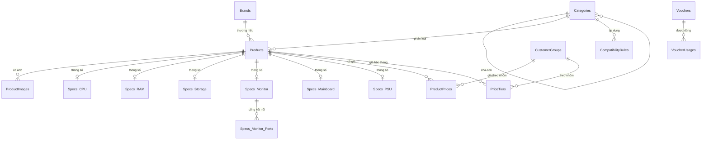
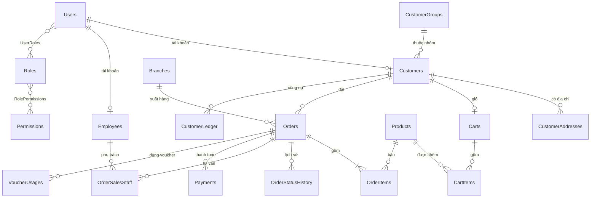
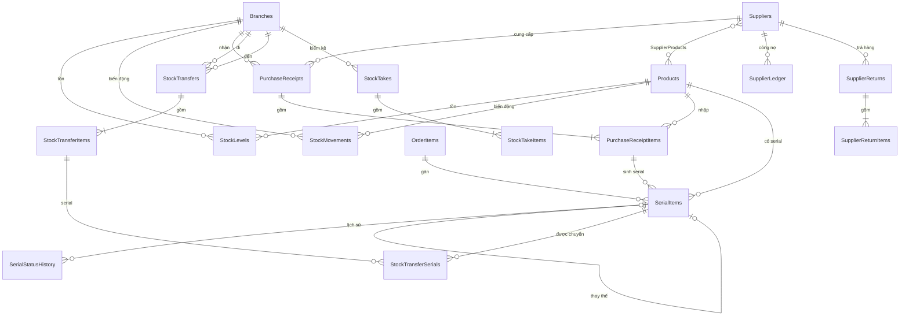
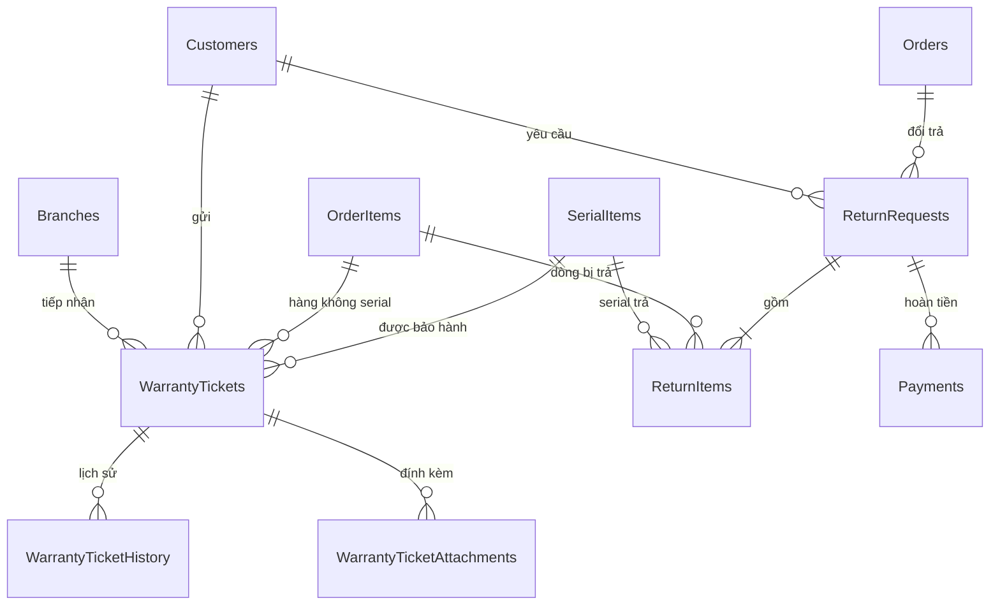
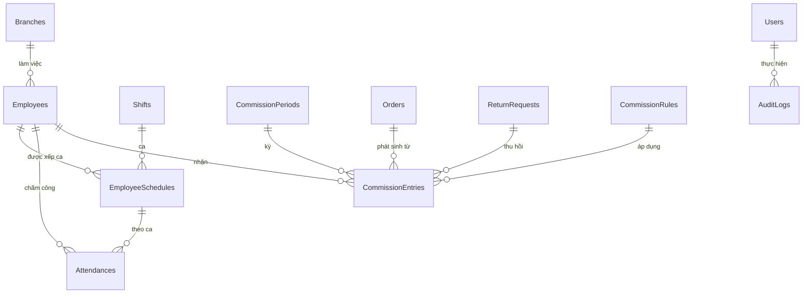

# THIẾT KẾ HỆ THỐNG: USE CASE, ERD, KHÓA VÀ CHỈ MỤC

**Hệ thống Bán hàng & Quản lý Doanh nghiệp Linh kiện Điện tử**


| Bước | Nội dung | Mục trong tài liệu |
|---|---|---|
| 2 | Xác định Actor và Use Case | Phần 1 |
| 3 | Xây dựng ERD | Phần 2 |
| 4 | Xác định PK, FK, Unique, Index | Phần 3 và 4 |

Mã yêu cầu (`ORD-xx`, `INV-xx`...) trỏ về BRD. CSDL mục tiêu: **SQL Server**.

---

## PHẦN 1. ACTOR VÀ USE CASE

### 1.1. Actor

| Actor | Mô tả |
|---|---|
| Khách hàng (Customer) | Khách lẻ hoặc khách sỉ, có tài khoản hoặc khách vãng lai |
| Thu ngân | Nhân viên bán tại quầy, thu tiền |
| Tư vấn kỹ thuật | Nhân viên tư vấn, gắn vào đơn để tính hoa hồng, tiếp nhận bảo hành |
| Thủ kho | Nhập, xuất, chuyển, kiểm kê kho, quản lý serial |
| Quản lý chi nhánh | Duyệt các thao tác nhạy cảm trong chi nhánh, xếp ca |
| Admin | Cấu hình toàn hệ thống |
| Hệ thống (System) | Tác vụ nền: hủy đơn quá hạn, cảnh báo tồn tối thiểu |
| Cổng thanh toán / Đơn vị vận chuyển | Actor ngoài, gọi callback về hệ thống |

### 1.2. Sơ đồ Use Case

```mermaid
flowchart LR
    KH([Khách hàng])
    NV([Thu ngân / Tư vấn])
    TK([Thủ kho])
    QL([Quản lý chi nhánh])
    AD([Admin])
    SYS([Hệ thống])
    PG([Cổng thanh toán])

    subgraph BH[Bán hàng]
        UC01(UC-01 Tìm kiếm và lọc)
        UC03(UC-03 Quản lý giỏ hàng)
        UC04(UC-04 Đặt hàng)
        UC05(UC-05 Thanh toán online)
        UC06(UC-06 Theo dõi và hủy đơn)
        UC09(UC-09 Tạo đơn tại quầy)
        UC10(UC-10 Xác nhận đơn)
        UC11(UC-11 Đóng gói và quét serial)
        UC12(UC-12 Bàn giao và cập nhật giao hàng)
    end
    subgraph KHO[Kho]
        UC13(UC-13 Nhập kho)
        UC14(UC-14 Chuyển kho)
        UC15(UC-15 Kiểm kê)
        UC21(UC-21 Duyệt điều chỉnh kho)
    end
    subgraph BHDT[Bảo hành và đổi trả]
        UC07(UC-07 Tra cứu bảo hành)
        UC08(UC-08 Yêu cầu đổi trả)
        UC16(UC-16 Tiếp nhận bảo hành)
        UC17(UC-17 Xử lý bảo hành)
        UC18(UC-18 Kiểm tra hàng trả)
        UC20(UC-20 Duyệt hủy, đổi trả, hoàn tiền)
    end
    subgraph QT[Quản trị]
        UC25(UC-25 Quản lý sản phẩm và thuộc tính)
        UC26(UC-26 Quản lý giá và khuyến mãi)
        UC27(UC-27 Quản lý nhân sự và phân quyền)
        UC28(UC-28 Chốt hoa hồng)
        UC29(UC-29 Xem Audit Log)
    end
    subgraph NEN[Tác vụ nền]
        UC33(UC-33 Hủy đơn quá hạn giữ hàng)
        UC34(UC-34 Cảnh báo tồn tối thiểu)
    end

    KH --- UC01 & UC03 & UC04 & UC05 & UC06 & UC07 & UC08
    NV --- UC09 & UC10 & UC11 & UC12 & UC16
    TK --- UC11 & UC13 & UC14 & UC15 & UC17 & UC18
    QL --- UC20 & UC21
    AD --- UC25 & UC26 & UC27 & UC28 & UC29
    SYS --- UC33 & UC34
    PG --- UC05
```



### 1.3. Danh sách Use Case

| Mã | Tên | Actor chính | Tiền điều kiện | Yêu cầu BRD |
|---|---|---|---|---|
| UC-01 | Tìm kiếm và lọc sản phẩm | Khách hàng | Không | PRD-12..14 |
| UC-02 | Xem chi tiết, kiểm tra tương thích | Khách hàng | Sản phẩm đang bán | PRD-10, PRD-11 |
| UC-03 | Quản lý giỏ hàng (thêm, sửa, tick chọn) | Khách hàng | Không (khách vãng lai có giỏ tạm) | CART-01..11 |
| UC-04 | Đặt hàng | Khách hàng | Có ít nhất một dòng được tick | ORD-01..06, ORD-10 |
| UC-05 | Thanh toán online | Khách hàng, Cổng thanh toán | Đơn ở `PendingPayment` | PAY-01..03 |
| UC-06 | Theo dõi và hủy đơn | Khách hàng | Đã đăng nhập hoặc có mã đơn | ORD-07, ORD-08 |
| UC-07 | Tra cứu bảo hành theo serial | Khách hàng, Nhân viên | Có serial hoặc mã đơn | SER-04, WAR-02 |
| UC-08 | Yêu cầu đổi trả | Khách hàng | Đơn `Completed`, còn hạn đổi trả | RET-01, RET-02 |
| UC-09 | Tạo đơn tại quầy | Thu ngân, Tư vấn | Đăng nhập, thuộc chi nhánh | ORD-03 |
| UC-10 | Xác nhận đơn | Thu ngân | Đơn `Pending` | ORD-07, ORD-08 |
| UC-11 | Đóng gói và quét serial | Thủ kho | Đơn `Confirmed` | SER-01, SER-02 |
| UC-12 | Bàn giao vận chuyển, cập nhật kết quả giao | Thu ngân, Thủ kho | Đơn `Packing` hoặc `Shipping` | ORD-07, PAY-05 |
| UC-13 | Nhập kho | Thủ kho | Có nhà cung cấp | INV-07..09 |
| UC-14 | Chuyển kho nội bộ | Thủ kho | Hai chi nhánh khác nhau | INV-06 |
| UC-15 | Kiểm kê | Thủ kho | Có phiếu kiểm kê | INV-05 |
| UC-16 | Tiếp nhận bảo hành | Tư vấn, Thu ngân | Có serial hoặc mã đơn | WAR-04, WAR-05 |
| UC-17 | Xử lý bảo hành (sửa, gửi hãng, đổi mới) | Thủ kho, Tư vấn | Phiếu đã tiếp nhận | WAR-06..08 |
| UC-18 | Kiểm tra hàng trả về | Thủ kho | Yêu cầu đổi trả đã được duyệt | RET-03 |
| UC-19 | Chấm công | Mọi nhân viên | Có ca làm | HR-05, HR-06 |
| UC-20 | Duyệt hủy đơn, đổi trả, hoàn tiền | Quản lý | Có yêu cầu chờ duyệt | ORD-07, RET-04, PAY-04 |
| UC-21 | Duyệt điều chỉnh tồn kho | Quản lý | Có phiếu điều chỉnh/kiểm kê chờ duyệt | INV-04, INV-05 |
| UC-22 | Xếp ca | Quản lý | Nhân viên thuộc chi nhánh | HR-04 |
| UC-23 | Duyệt điều chỉnh công | Quản lý | Có đề xuất điều chỉnh | HR-06 |
| UC-24 | Xem báo cáo chi nhánh | Quản lý | Không | Mục 11 BRD |
| UC-25 | Quản lý sản phẩm và thuộc tính | Admin | Không | PRD-01..09 |
| UC-26 | Quản lý giá, khuyến mãi, voucher | Admin | Không | PRC-01..08 |
| UC-27 | Quản lý nhân sự và phân quyền | Admin | Không | HR-01..03 |
| UC-28 | Chốt kỳ hoa hồng | Admin | Kỳ đang mở | KPI-01..06 |
| UC-29 | Xem Audit Log | Admin, Quản lý | Không | AUD-01..04 |
| UC-30 | Cấu hình hệ thống (timeout, hạn đổi trả...) | Admin | Không | Mục 1.4 BRD |
| UC-31 | Quản lý nhà cung cấp và công nợ | Admin, Thủ kho | Không | SUP-01..03 |
| UC-32 | Báo cáo toàn hệ thống | Admin | Không | Mục 11 BRD |
| UC-33 | Hủy đơn quá hạn giữ hàng | Hệ thống | Có đơn quá hạn | ORD-11 |
| UC-34 | Cảnh báo tồn tối thiểu | Hệ thống | Tồn thấp hơn ngưỡng | INV-02 |

### 1.4. Đặc tả các Use Case chính

#### UC-04 Đặt hàng

| Mục | Nội dung |
|---|---|
| Actor | Khách hàng |
| Tiền điều kiện | Giỏ có ít nhất một dòng `IsSelected = true` |
| Hậu điều kiện | Đơn được tạo, tồn kho được giữ, các dòng đã chọn bị xóa khỏi giỏ |

**Luồng chính**

1. Khách bấm "Đặt hàng". Hệ thống kiểm tra lại tồn khả dụng của từng dòng được tick (CART-07).
2. Khách chọn hình thức nhận hàng (giao tận nơi hoặc nhận tại chi nhánh) và địa chỉ/chi nhánh.
3. Khách chọn phương thức thanh toán, nhập voucher (nếu có).
4. Hệ thống tính giá cuối (giá nhóm khách, bậc thang, khuyến mãi, voucher theo PRC-05) và hiển thị tổng kết.
5. Khách xác nhận. Trong **một giao dịch**, hệ thống: tạo `Orders` và `OrderItems` (snapshot giá, tên, bảo hành), tăng `ReservedQty` trong `StockLevels` cho từng sản phẩm, ghi `StockMovements`, ghi lịch sử trạng thái, xóa các dòng đã chọn khỏi giỏ.
6. Trạng thái đơn: `PendingPayment` (chuyển khoản, cổng thanh toán) hoặc `Pending` (COD). Đơn có `ExpiresAt` nếu ở `PendingPayment`.

**Luồng thay thế / ngoại lệ**

| Mã | Tình huống | Xử lý |
|---|---|---|
| A1 | Bước 1: sản phẩm hết hàng | Bỏ tick, báo khách, quay về giỏ |
| A2 | Bước 1: tồn ít hơn số lượng đặt | Giảm số lượng về mức khả dụng, báo khách, khách xác nhận tiếp |
| A3 | Bước 4: giá khác lần xem trước | Hiển thị giá mới, yêu cầu khách xác nhận lại |
| A4 | Bước 5: hai khách cùng giành món cuối | Giao dịch của khách đến sau thất bại, báo hết hàng, không tạo đơn |
| A5 | Voucher không hợp lệ | Báo lỗi cụ thể, cho phép bỏ voucher và tiếp tục |
| A6 | Khách sỉ vượt hạn mức công nợ | Với phương thức Công nợ: chặn, hoặc chuyển Quản lý duyệt (PRC-08) |

#### UC-11 Đóng gói và quét serial

| Mục | Nội dung |
|---|---|
| Actor | Thủ kho |
| Tiền điều kiện | Đơn `Confirmed` thuộc chi nhánh của thủ kho |
| Hậu điều kiện | Mọi sản phẩm `RequiresSerial` đã được gán đủ serial; đơn `Packing` |

**Luồng chính**

1. Thủ kho mở đơn, hệ thống hiển thị danh sách dòng và số serial cần gán.
2. Thủ kho quét từng serial. Hệ thống kiểm tra: serial tồn tại, đúng sản phẩm, đúng chi nhánh, trạng thái `InStock` (SER-01).
3. Serial chuyển `InStock` sang `Allocated`, gắn `OrderItemId`, ghi `SerialStatusHistory`.
4. Khi đủ số lượng cho mọi dòng, đơn chuyển `Packing`, sau đó `ReadyForPickup` hoặc `Shipping` ở UC-12.

**Ngoại lệ**: quét serial sai sản phẩm hoặc không ở `InStock` bị từ chối kèm lý do. Gỡ gán nhầm: cho phép khi đơn chưa giao, serial trở về `InStock`, ghi Audit Log (SER-02).

#### UC-13 Nhập kho

| Mục | Nội dung |
|---|---|
| Actor | Thủ kho |
| Tiền điều kiện | Nhà cung cấp tồn tại và đang hoạt động |
| Hậu điều kiện | Tồn tăng, serial được tạo, công nợ nhà cung cấp phát sinh |

**Luồng chính**

1. Tạo phiếu nhập: chọn nhà cung cấp, chi nhánh nhận, thêm dòng (sản phẩm, số lượng, đơn giá).
2. Với dòng `RequiresSerial`, nhập hoặc quét đủ số serial bằng số lượng.
3. Bấm hoàn tất. Hệ thống kiểm tra trùng serial (INV-08).
4. Trong một giao dịch: tăng `PhysicalQty`, tạo `SerialItems` (`InStock`), ghi `StockMovements`, cập nhật giá vốn, ghi `SupplierLedger` (phải trả).

**Ngoại lệ**: thiếu serial thì không hoàn tất; trùng serial thì báo rõ serial trùng và từ chối toàn phiếu.

#### UC-12 / UC-06 Hủy đơn

| Mục | Nội dung |
|---|---|
| Actor | Khách hàng (khi `Pending`/`PendingPayment`), Quản lý (khi `Confirmed`/`Packing`) |
| Hậu điều kiện | Đơn `Cancelled`, tồn khả dụng được nhả, serial đã gán trở về `InStock` |

**Luồng chính**: nhập lý do, kiểm tra quyền theo trạng thái, trong một giao dịch giảm `ReservedQty`, gỡ gán serial (nếu có), ghi `StockMovements`, hoàn tiền nếu đã thanh toán (UC-20), ghi lịch sử trạng thái và Audit Log.

**Ngoại lệ**: đơn đã `Shipping` không hủy trực tiếp; phải ghi nhận giao thất bại rồi hoàn về kho.

#### UC-16 / UC-17 Bảo hành

**Luồng chính (tiếp nhận)**

1. Nhân viên quét serial. Hệ thống hiển thị sản phẩm, ngày mua, khách hàng, hạn bảo hành còn lại.
2. Còn hạn: ghi tình trạng, phụ kiện, tạo phiếu `Received`, serial chuyển `RMA`.
3. Hết hạn hoặc không đủ điều kiện: chuyển `Rejected` kèm lý do (WAR-05).

**Luồng chính (xử lý)**: chẩn đoán, sửa tại chỗ hoặc gửi hãng, nhận kết quả. Nếu đổi mới: serial mới (đã `InStock`) được bán cho phiếu, serial cũ thành `Replaced`, hạn bảo hành serial mới kế thừa phần còn lại của serial cũ (WAR-06). Cuối cùng trả khách, phiếu `ReturnedToCustomer`.

#### UC-08 / UC-18 Đổi trả

1. Khách gửi yêu cầu cho đơn `Completed` còn hạn, chọn dòng và số lượng, nêu lý do.
2. Quản lý duyệt hoặc từ chối (UC-20).
3. Hàng về, thủ kho kiểm tra từng serial: đạt thì `InStock` và cộng lại `PhysicalQty`; không đạt thì `Defective`.
4. Hệ thống tạo giao dịch hoàn tiền, cập nhật đơn thành `PartiallyReturned` hoặc `Returned`, ghi bút toán thu hồi hoa hồng (KPI-04).

#### UC-33 Hủy đơn quá hạn giữ hàng (tác vụ nền)

Chạy định kỳ (ví dụ mỗi phút): tìm đơn `PendingPayment` có `ExpiresAt` đã qua và đơn `ReadyForPickup` quá hạn nhận. Với mỗi đơn, trong một giao dịch: chuyển `Cancelled` với lý do "Quá hạn", giảm `ReservedQty`, gỡ serial, ghi lịch sử. Tác vụ phải **idempotent**: chạy lại hoặc chạy chồng không làm nhả tồn hai lần (kiểm tra lại trạng thái trong giao dịch).

---

## PHẦN 2. ERD

Để dễ đọc, ERD chia theo module. Chi tiết cột nằm ở Phần 3. Ký hiệu: `||--o{` là một-nhiều, `||--||` là một-một, `}o--o{` là nhiều-nhiều (qua bảng trung gian).

### 2.1. Danh mục hàng hóa và giá



### 2.2. Khách hàng, giỏ hàng, đơn hàng, thanh toán



### 2.3. Kho, serial, nhà cung cấp



### 2.4. Bảo hành và đổi trả



### 2.5. Nhân sự, hoa hồng, nhật ký



---

## PHẦN 3. ĐỊNH NGHĨA BẢNG (PK, FK, UNIQUE, CHECK)

### 3.1. Quy ước chung

| Quy ước | Nội dung |
|---|---|
| Khóa chính | `Id bigint IDENTITY`, trừ bảng ghi rõ khóa chính tổng hợp hoặc PK = FK |
| Tiền tệ | `decimal(18,0)` (VND, số nguyên) |
| Thời gian | `datetime2(0)`, lưu UTC |
| Chuỗi tiếng Việt | `nvarchar`; mã kỹ thuật (SKU, serial) dùng `varchar` |
| Cột audit | Mọi bảng nghiệp vụ có `CreatedAt`, `CreatedBy`, `UpdatedAt`, `UpdatedBy` (không lặp lại bên dưới) |
| Khóa ngoại | Mặc định `ON DELETE NO ACTION`. Chỉ dùng `CASCADE` ở bảng con thuần túy ghi rõ (`CartItems`, `ProductImages`, `Specs_*`) |
| Xóa | Không xóa cứng dữ liệu có phát sinh; dùng `IsActive` hoặc trạng thái |
| Đồng thời | `RowVersion rowversion` ở bảng nhiều người cập nhật cùng lúc (`StockLevels`, `Orders`, `SerialItems`) |
| Trạng thái | `tinyint`, ánh xạ sang enum trong code, giá trị liệt kê trong chú thích |

Ký hiệu: **PK** khóa chính, **FK→Bảng** khóa ngoại, **UQ** duy nhất, **CK** ràng buộc kiểm tra, **NN** không null (mặc định không ghi thì là NN, cột nullable ghi `NULL`).

### 3.2. Module Chung: người dùng, phân quyền, chi nhánh

```
Users
  Id                 bigint         PK
  Username           varchar(50)    UQ
  Email              varchar(150)   NULL, UQ lọc (WHERE Email IS NOT NULL)
  Phone              varchar(20)    NULL
  PasswordHash       varchar(255)
  UserType           tinyint        0 Customer, 1 Employee
  IsActive           bit            DEFAULT 1
  LastLoginAt        datetime2      NULL

Roles
  Id                 int            PK
  Code               varchar(50)    UQ     -- Customer, Cashier, TechAdvisor, Storekeeper, Manager, Admin
  Name               nvarchar(100)

Permissions
  Id                 int            PK
  Code               varchar(100)   UQ     -- ví dụ order.cancel.approve, stock.adjust.approve

UserRoles
  UserId             bigint         PK, FK→Users
  RoleId             int            PK, FK→Roles

RolePermissions
  RoleId             int            PK, FK→Roles
  PermissionId       int            PK, FK→Permissions

Branches
  Id                 int            PK
  Code               varchar(20)    UQ
  Name               nvarchar(150)
  Address            nvarchar(300)
  Phone              varchar(20)    NULL
  IsActive           bit            DEFAULT 1

SystemSettings
  [Key]              varchar(100)   PK     -- hold.payment.minutes, hold.transfer.hours, pickup.days, return.days...
  Value              nvarchar(500)
  Description        nvarchar(300)  NULL
```

### 3.3. Module Danh mục hàng hóa

```
Categories
  Id                 int            PK
  Code               varchar(30)    UQ
  Name               nvarchar(100)
  SpecType           tinyint        -- 0 Generic, 1 CPU, 2 RAM, 3 Storage, 4 Monitor, 5 Mainboard, 6 PSU
  ParentId           int            NULL, FK→Categories
  IsActive           bit

Brands
  Id                 int            PK
  Name               nvarchar(100)  UQ
  IsActive           bit

Products
  Id                 bigint         PK
  Sku                varchar(50)    UQ
  Name               nvarchar(250)
  Slug               varchar(300)   UQ
  BrandId            int            FK→Brands
  CategoryId         int            FK→Categories
  ShortDescription   nvarchar(500)  NULL
  Description        nvarchar(max)  NULL
  LastImportPrice    decimal(18,0)  NULL  -- tham khảo, giá vốn thực tế tính từ phiếu nhập
  ListPrice          decimal(18,0)  CK >= 0
  RequiresSerial     bit
  MinStockDefault    int            DEFAULT 0, CK >= 0
  WarrantyMonths     int            CK >= 0
  WarrantyTerms      nvarchar(1000) NULL
  Status             tinyint        -- 0 Draft, 1 Active, 2 Discontinued   (Hết hàng suy ra từ tồn, không lưu)

ProductImages
  Id                 bigint         PK
  ProductId          bigint         FK→Products ON DELETE CASCADE
  Url                varchar(500)
  SortOrder          int
  IsPrimary          bit

Specs_CPU
  ProductId          bigint         PK, FK→Products ON DELETE CASCADE
  Socket             varchar(20)
  Cores              smallint
  Threads            smallint
  BaseClockGhz       decimal(4,2)
  BoostClockGhz      decimal(4,2)   NULL
  CacheMb            smallint
  TdpW               smallint
  HasCooler          bit
  HasIntegratedGpu   bit

Specs_RAM
  ProductId          bigint         PK, FK→Products
  MemoryType         varchar(10)    -- DDR4, DDR5
  CapacityGbPerKit   smallint
  ModulesPerKit      tinyint        CK IN (1,2,4)
  BusMhz             int
  CasLatency         tinyint
  FormFactor         varchar(10)    -- DIMM, SODIMM
  HasRgb             bit

Specs_Storage
  ProductId          bigint         PK, FK→Products
  StorageType        varchar(20)    -- SSD NVMe, SSD SATA, HDD
  Interface          varchar(30)    -- PCIe Gen4 x4, SATA III
  FormFactor         varchar(20)    -- M.2 2280, 2.5in, 3.5in
  CapacityGb         int
  ReadMbps           int            NULL
  WriteMbps          int            NULL

Specs_Monitor
  ProductId          bigint         PK, FK→Products
  SizeInch           decimal(4,1)
  Resolution         varchar(20)    -- FHD, 2K, 4K
  PanelType          varchar(10)    -- IPS, VA, OLED
  RefreshRateHz      smallint
  ResponseTimeMs     decimal(4,1)
  SrgbPercent        tinyint        NULL

Specs_Monitor_Ports
  ProductId          bigint         PK, FK→Specs_Monitor ON DELETE CASCADE
  PortType           varchar(20)    PK    -- HDMI, DP, TypeC
  Quantity           tinyint

Specs_Mainboard
  ProductId          bigint         PK, FK→Products
  Socket             varchar(20)
  Chipset            varchar(30)
  MemoryType         varchar(10)
  RamSlots           tinyint
  MaxBusMhz          int
  FormFactor         varchar(10)    -- ATX, mATX, ITX
  M2Slots            tinyint
  SataPorts          tinyint

Specs_PSU
  ProductId          bigint         PK, FK→Products
  PowerW             smallint
  EfficiencyRating   varchar(20)    NULL
  ModularType        varchar(10)    NULL   -- Full, Semi, Non

CompatibilityRules
  Id                 int            PK
  Name               nvarchar(150)
  LeftCategoryId     int            FK→Categories
  RightCategoryId    int            FK→Categories
  LeftField          varchar(50)
  RightField         varchar(50)
  Operator           varchar(10)    -- EQ, LTE, GTE
  Severity           tinyint        -- 0 Info, 1 Warning
  IsActive           bit
```

**Ràng buộc giữ cho quan hệ 1-1 Cha-Con đúng (PRD-01, PRD-02):**
`Products.CategoryId` quyết định bảng con. Việc "sản phẩm chỉ có bản ghi ở đúng một bảng con khớp Category" được kiểm tra ở tầng ứng dụng khi tạo/sửa (cùng giao dịch ghi cha và con); nếu cần cưỡng chế ở tầng CSDL, thêm cột `SpecType` vào `Products` (sao chép từ Category), đặt `UQ (Id, SpecType)` và để mỗi bảng con có cột `SpecType` cố định bằng `CK` rồi `FK (ProductId, SpecType) → Products (Id, SpecType)`.

### 3.4. Module Giá và khuyến mãi

```
CustomerGroups
  Id                 int            PK
  Code               varchar(30)    UQ     -- RETAIL, WHOLESALE
  Name               nvarchar(100)
  IsDefault          bit            -- UQ lọc: chỉ một nhóm IsDefault = 1

ProductPrices
  Id                 bigint         PK
  ProductId          bigint         FK→Products
  CustomerGroupId    int            FK→CustomerGroups
  Price              decimal(18,0)  CK >= 0
  UQ (ProductId, CustomerGroupId)

PriceTiers
  Id                 bigint         PK
  ProductId          bigint         FK→Products
  CustomerGroupId    int            FK→CustomerGroups
  MinQuantity        int            CK > 1
  Price              decimal(18,0)  CK >= 0
  UQ (ProductId, CustomerGroupId, MinQuantity)

Promotions
  Id                 bigint         PK
  Name               nvarchar(200)
  ScopeType          tinyint        -- 0 Product, 1 Brand, 2 Category
  ScopeId            bigint
  DiscountType       tinyint        -- 0 Percent, 1 Amount
  DiscountValue      decimal(18,2)  CK > 0
  StartAt            datetime2
  EndAt              datetime2      CK EndAt > StartAt
  MaxQuantity        int            NULL
  MaxPerCustomer     int            NULL
  IsActive           bit

Vouchers
  Id                 bigint         PK
  Code               varchar(40)    UQ
  DiscountType       tinyint
  DiscountValue      decimal(18,2)  CK > 0
  MinOrderAmount     decimal(18,0)  NULL
  MaxDiscountAmount  decimal(18,0)  NULL
  StartAt            datetime2
  EndAt              datetime2      CK EndAt > StartAt
  MaxUses            int            NULL
  UsedCount          int            DEFAULT 0, CK >= 0
  CustomerGroupId    int            NULL, FK→CustomerGroups
  IsStackable        bit
  IsActive           bit

VoucherUsages
  Id                 bigint         PK
  VoucherId          bigint         FK→Vouchers
  OrderId            bigint         FK→Orders
  CustomerId         bigint         NULL, FK→Customers
  DiscountAmount     decimal(18,0)
  UQ (VoucherId, OrderId)
```

### 3.5. Module Khách hàng, giỏ hàng, đơn hàng, thanh toán

```
Customers
  Id                 bigint         PK
  UserId             bigint         NULL, UQ lọc (WHERE UserId IS NOT NULL), FK→Users
  FullName           nvarchar(150)
  Phone              varchar(20)
  Email              varchar(150)   NULL
  CustomerGroupId    int            FK→CustomerGroups
  TaxCode            varchar(20)    NULL
  CreditLimit        decimal(18,0)  DEFAULT 0
  PaymentTermDays    int            DEFAULT 0
  IsActive           bit

CustomerAddresses
  Id                 bigint         PK
  CustomerId         bigint         FK→Customers
  RecipientName      nvarchar(150)
  Phone              varchar(20)
  Province           nvarchar(100)
  District           nvarchar(100)
  Ward               nvarchar(100)
  Street             nvarchar(250)
  IsDefault          bit            -- UQ lọc (CustomerId) WHERE IsDefault = 1

Carts
  Id                 bigint         PK
  CustomerId         bigint         NULL, FK→Customers, UQ lọc (WHERE CustomerId IS NOT NULL)
  SessionToken       varchar(64)    NULL, UQ lọc (WHERE SessionToken IS NOT NULL)
  CK (CustomerId IS NOT NULL OR SessionToken IS NOT NULL)

CartItems
  Id                 bigint         PK
  CartId             bigint         FK→Carts ON DELETE CASCADE
  ProductId          bigint         FK→Products
  Quantity           int            CK > 0
  IsSelected         bit            DEFAULT 1
  AddedAt            datetime2
  UQ (CartId, ProductId)

Orders
  Id                 bigint         PK
  OrderCode          varchar(30)    UQ
  CustomerId         bigint         FK→Customers
  BranchId           int            FK→Branches       -- chi nhánh xuất hàng
  Channel            tinyint        -- 0 Online, 1 POS
  FulfillmentType    tinyint        -- 0 Delivery, 1 Pickup
  Status             tinyint        -- 0 PendingPayment, 1 Pending, 2 Confirmed, 3 Packing, 4 ReadyForPickup,
                                    -- 5 Shipping, 6 DeliveryFailed, 7 Completed, 8 Cancelled,
                                    -- 9 PartiallyReturned, 10 Returned
  RecipientName      nvarchar(150)  NULL   -- snapshot địa chỉ giao
  RecipientPhone     varchar(20)    NULL
  ShippingAddress    nvarchar(500)  NULL
  SubTotal           decimal(18,0)
  DiscountTotal      decimal(18,0)  DEFAULT 0
  ShippingFee        decimal(18,0)  DEFAULT 0
  GrandTotal         decimal(18,0)  CK = SubTotal - DiscountTotal + ShippingFee
  PaidAmount         decimal(18,0)  DEFAULT 0
  PaymentMethod      tinyint        -- 0 COD, 1 BankTransfer, 2 Gateway, 3 Cash/POS, 4 Credit
  PaymentStatus      tinyint        -- 0 Unpaid, 1 PartiallyPaid, 2 Paid, 3 Refunded
  VoucherId          bigint         NULL, FK→Vouchers
  ExpiresAt          datetime2      NULL  -- hạn giữ hàng / hạn nhận hàng
  CompletedAt        datetime2      NULL
  Note               nvarchar(500)  NULL
  RowVersion         rowversion

OrderItems
  Id                 bigint         PK
  OrderId            bigint         FK→Orders
  ProductId          bigint         FK→Products
  Sku                varchar(50)    -- snapshot
  ProductName        nvarchar(250)  -- snapshot
  UnitPrice          decimal(18,0)  -- snapshot, giá sau khi áp bảng giá/bậc thang
  DiscountAmount     decimal(18,0)  DEFAULT 0
  Quantity           int            CK > 0
  LineTotal          decimal(18,0)  CK = UnitPrice * Quantity - DiscountAmount
  WarrantyMonths     int            -- snapshot (ORD-04)
  RequiresSerial     bit            -- snapshot
  PromotionId        bigint         NULL, FK→Promotions
  UQ (OrderId, ProductId)

OrderStatusHistory
  Id                 bigint         PK
  OrderId            bigint         FK→Orders
  FromStatus         tinyint        NULL
  ToStatus           tinyint
  Reason             nvarchar(300)  NULL
  ChangedBy          bigint         NULL, FK→Users     -- NULL nếu do hệ thống
  ChangedAt          datetime2

OrderSalesStaff
  OrderId            bigint         PK, FK→Orders
  EmployeeId         bigint         PK, FK→Employees
  ShareRate          decimal(5,2)   CK BETWEEN 0 AND 100
  IsPrimary          bit            -- tổng ShareRate của một đơn = 100 kiểm tra ở tầng ứng dụng

Payments
  Id                 bigint         PK
  OrderId            bigint         FK→Orders
  PaymentType        tinyint        -- 0 Payment, 1 Refund
  Method             tinyint
  Amount             decimal(18,0)  CK > 0
  Status             tinyint        -- 0 Pending, 1 Succeeded, 2 Failed
  Provider           varchar(30)    NULL
  ProviderTransactionId varchar(100) NULL
  ParentPaymentId    bigint         NULL, FK→Payments      -- giao dịch hoàn trỏ về giao dịch gốc
  ReturnRequestId    bigint         NULL, FK→ReturnRequests
  PaidAt             datetime2      NULL
  UQ lọc (Provider, ProviderTransactionId) WHERE ProviderTransactionId IS NOT NULL   -- chống xử lý callback trùng (PAY-02)

CustomerLedger
  Id                 bigint         PK
  CustomerId         bigint         FK→Customers
  OrderId            bigint         NULL, FK→Orders
  PaymentId          bigint         NULL, FK→Payments
  EntryType          tinyint        -- 0 Charge, 1 Payment, 2 Adjustment
  Amount             decimal(18,0)  -- dương: phát sinh nợ, âm: giảm nợ
  DueDate            date           NULL
```

### 3.6. Module Kho, serial, nhà cung cấp

```
Suppliers
  Id                 bigint         PK
  Code               varchar(30)    UQ
  Name               nvarchar(200)
  TaxCode            varchar(20)    NULL
  Phone              varchar(20)    NULL
  Address            nvarchar(300)  NULL
  PaymentTermDays    int            DEFAULT 0
  IsActive           bit

SupplierProducts
  SupplierId         bigint         PK, FK→Suppliers
  ProductId          bigint         PK, FK→Products
  SupplierSku        varchar(50)    NULL

StockLevels
  BranchId           int            PK, FK→Branches
  ProductId          bigint         PK, FK→Products
  PhysicalQty        int            CK >= 0
  ReservedQty        int            CK >= 0
  AvailableQty       AS (PhysicalQty - ReservedQty) PERSISTED
  MinStock           int            NULL      -- NULL: dùng MinStockDefault của sản phẩm
  RowVersion         rowversion
  CK (ReservedQty <= PhysicalQty)

StockMovements                       -- bất biến, chỉ INSERT (INV-03)
  Id                 bigint         PK
  BranchId           int            FK→Branches
  ProductId          bigint         FK→Products
  MovementType       tinyint        -- 0 Receipt, 1 Reserve, 2 Release, 3 Issue, 4 TransferOut, 5 TransferIn,
                                    -- 6 StockTakeAdjust, 7 ManualAdjust, 8 CustomerReturn, 9 SupplierReturn
  PhysicalDelta      int
  ReservedDelta      int
  RefType            varchar(30)    -- Order, PurchaseReceipt, StockTransfer, StockTake, ReturnRequest...
  RefId              bigint
  Note               nvarchar(300)  NULL
  CreatedAt          datetime2
  CreatedBy          bigint         NULL, FK→Users

PurchaseReceipts
  Id                 bigint         PK
  ReceiptCode        varchar(30)    UQ
  SupplierId         bigint         FK→Suppliers
  BranchId           int            FK→Branches
  SupplierInvoiceNo  varchar(50)    NULL
  Status             tinyint        -- 0 Draft, 1 Completed, 2 Cancelled
  TotalAmount        decimal(18,0)
  ReceivedAt         datetime2      NULL

PurchaseReceiptItems
  Id                 bigint         PK
  ReceiptId          bigint         FK→PurchaseReceipts
  ProductId          bigint         FK→Products
  Quantity           int            CK > 0
  UnitCost           decimal(18,0)  CK >= 0
  UQ (ReceiptId, ProductId)

SerialItems
  Id                 bigint         PK
  ProductId          bigint         FK→Products
  SerialNumber       varchar(100)
  Status             tinyint        -- 0 InStock, 1 Allocated, 2 InTransfer, 3 Sold, 4 RMA, 5 Returned,
                                    -- 6 Replaced, 7 Defective, 8 ReturnedToSupplier, 9 Scrapped
  BranchId           int            FK→Branches       -- vị trí hiện tại
  PurchaseReceiptItemId bigint      FK→PurchaseReceiptItems
  UnitCost           decimal(18,0)
  OrderItemId        bigint         NULL, FK→OrderItems   -- đơn đang gán / đã bán
  SoldAt             datetime2      NULL
  WarrantyStartDate  date           NULL
  WarrantyEndDate    date           NULL
  ReplacedBySerialId bigint         NULL, FK→SerialItems
  RowVersion         rowversion
  UQ (ProductId, SerialNumber)      -- BRD mục 13 điểm 3: đổi thành UQ (SerialNumber) nếu chọn duy nhất toàn hệ thống
  CK (Status <> 3 OR OrderItemId IS NOT NULL)   -- đã bán thì phải gắn đơn

SerialStatusHistory
  Id                 bigint         PK
  SerialItemId       bigint         FK→SerialItems
  FromStatus         tinyint        NULL
  ToStatus           tinyint
  RefType            varchar(30)    NULL
  RefId              bigint         NULL
  Note               nvarchar(300)  NULL
  ChangedBy          bigint         NULL, FK→Users
  ChangedAt          datetime2

StockTransfers
  Id                 bigint         PK
  TransferCode       varchar(30)    UQ
  FromBranchId       int            FK→Branches
  ToBranchId         int            FK→Branches
  Status             tinyint        -- 0 Draft, 1 InTransit, 2 Received, 3 Cancelled
  CK (FromBranchId <> ToBranchId)

StockTransferItems
  Id                 bigint         PK
  TransferId         bigint         FK→StockTransfers
  ProductId          bigint         FK→Products
  Quantity           int            CK > 0
  UQ (TransferId, ProductId)

StockTransferSerials
  TransferItemId     bigint         PK, FK→StockTransferItems
  SerialItemId       bigint         PK, FK→SerialItems

StockTakes
  Id                 bigint         PK
  StockTakeCode      varchar(30)    UQ
  BranchId           int            FK→Branches
  Status             tinyint        -- 0 Draft, 1 Counting, 2 PendingApproval, 3 Approved, 4 Rejected
  ApprovedBy         bigint         NULL, FK→Users
  ApprovedAt         datetime2      NULL

StockTakeItems
  Id                 bigint         PK
  StockTakeId        bigint         FK→StockTakes
  ProductId          bigint         FK→Products
  SystemQty          int
  CountedQty         int
  DiffQty            AS (CountedQty - SystemQty) PERSISTED
  Reason             nvarchar(300)  NULL
  UQ (StockTakeId, ProductId)

SupplierLedger
  Id                 bigint         PK
  SupplierId         bigint         FK→Suppliers
  PurchaseReceiptId  bigint         NULL, FK→PurchaseReceipts
  SupplierReturnId   bigint         NULL, FK→SupplierReturns
  EntryType          tinyint        -- 0 Payable, 1 Payment, 2 ReturnCredit
  Amount             decimal(18,0)
  DueDate            date           NULL

SupplierReturns
  Id                 bigint         PK
  ReturnCode         varchar(30)    UQ
  SupplierId         bigint         FK→Suppliers
  BranchId           int            FK→Branches
  Status             tinyint        -- 0 Draft, 1 Completed, 2 Cancelled

SupplierReturnItems
  Id                 bigint         PK
  SupplierReturnId   bigint         FK→SupplierReturns
  ProductId          bigint         FK→Products
  SerialItemId       bigint         NULL, FK→SerialItems
  Quantity           int            CK > 0
```

### 3.7. Module Bảo hành và đổi trả

```
WarrantyTickets
  Id                 bigint         PK
  TicketCode         varchar(30)    UQ
  SerialItemId       bigint         NULL, FK→SerialItems          -- hàng có serial
  OrderItemId        bigint         NULL, FK→OrderItems           -- hàng không serial (WAR-03)
  CustomerId         bigint         FK→Customers
  BranchId           int            FK→Branches
  Status             tinyint        -- 0 Received, 1 Diagnosing, 2 SentToVendor, 3 Repaired, 4 Replaced,
                                    -- 5 Rejected, 6 ReturnedToCustomer
  IssueDescription   nvarchar(1000)
  ConditionNotes     nvarchar(1000) NULL
  RejectionReason    nvarchar(500)  NULL
  ReplacementSerialId bigint        NULL, FK→SerialItems
  VendorSentAt       datetime2      NULL
  VendorReturnedAt   datetime2      NULL
  ReceivedAt         datetime2
  ReturnedAt         datetime2      NULL
  Fee                decimal(18,0)  DEFAULT 0
  CK (SerialItemId IS NOT NULL OR OrderItemId IS NOT NULL)

WarrantyTicketHistory
  Id                 bigint         PK
  TicketId           bigint         FK→WarrantyTickets
  FromStatus         tinyint        NULL
  ToStatus           tinyint
  Note               nvarchar(500)  NULL
  ChangedBy          bigint         NULL, FK→Users
  ChangedAt          datetime2

WarrantyTicketAttachments
  Id                 bigint         PK
  TicketId           bigint         FK→WarrantyTickets
  Url                varchar(500)

ReturnRequests
  Id                 bigint         PK
  ReturnCode         varchar(30)    UQ
  OrderId            bigint         FK→Orders
  CustomerId         bigint         FK→Customers
  BranchId           int            FK→Branches
  Status             tinyint        -- 0 Requested, 1 Approved, 2 Rejected, 3 GoodsReceived, 4 Refunded, 5 Closed
  Reason             nvarchar(500)
  RefundAmount       decimal(18,0)  DEFAULT 0
  ApprovedBy         bigint         NULL, FK→Users
  ApprovedAt         datetime2      NULL

ReturnItems
  Id                 bigint         PK
  ReturnRequestId    bigint         FK→ReturnRequests
  OrderItemId        bigint         FK→OrderItems
  SerialItemId       bigint         NULL, FK→SerialItems
  Quantity           int            CK > 0
  InspectionResult   tinyint        -- 0 Pending, 1 Pass, 2 Fail
  UQ lọc (ReturnRequestId, SerialItemId) WHERE SerialItemId IS NOT NULL
```

### 3.8. Module Nhân sự, hoa hồng, nhật ký

```
Employees
  Id                 bigint         PK
  EmployeeCode       varchar(20)    UQ
  UserId             bigint         UQ, FK→Users
  FullName           nvarchar(150)
  Phone              varchar(20)    NULL
  Position           tinyint        -- 0 Cashier, 1 TechAdvisor, 2 Storekeeper, 3 Manager
  BranchId           int            FK→Branches
  Status             tinyint        -- 0 Active, 1 Terminated
  HireDate           date
  TerminatedDate     date           NULL

Shifts
  Id                 int            PK
  Code               varchar(20)    UQ    -- MORNING, AFTERNOON, FULL
  Name               nvarchar(50)
  StartTime          time
  EndTime            time

EmployeeSchedules
  Id                 bigint         PK
  EmployeeId         bigint         FK→Employees
  ShiftId            int            FK→Shifts
  BranchId           int            FK→Branches
  WorkDate           date
  UQ (EmployeeId, WorkDate, ShiftId)

Attendances
  Id                 bigint         PK
  EmployeeId         bigint         FK→Employees
  ScheduleId         bigint         NULL, FK→EmployeeSchedules
  WorkDate           date
  CheckInAt          datetime2      NULL
  CheckOutAt         datetime2      NULL
  Source             tinyint        -- 0 Device, 1 ManualAdjust
  AdjustedBy         bigint         NULL, FK→Users
  AdjustReason       nvarchar(300)  NULL
  UQ lọc (EmployeeId, ScheduleId) WHERE ScheduleId IS NOT NULL
  CK (CheckOutAt IS NULL OR CheckInAt IS NULL OR CheckOutAt >= CheckInAt)

CommissionRules
  Id                 int            PK
  Name               nvarchar(150)
  ScopeType          tinyint        -- 0 All, 1 Category, 2 Product
  ScopeId            bigint         NULL
  BasisType          tinyint        -- 0 Revenue, 1 GrossProfit
  RatePercent        decimal(5,2)   CK BETWEEN 0 AND 100
  TargetAmount       decimal(18,0)  NULL
  BonusRatePercent   decimal(5,2)   NULL
  EffectiveFrom      date
  EffectiveTo        date           NULL

CommissionPeriods
  Id                 int            PK
  YearMonth          char(7)        UQ    -- 2026-11
  Status             tinyint        -- 0 Open, 1 Closed
  ClosedBy           bigint         NULL, FK→Users
  ClosedAt           datetime2      NULL

CommissionEntries
  Id                 bigint         PK
  PeriodId           int            FK→CommissionPeriods
  EmployeeId         bigint         FK→Employees
  OrderId            bigint         FK→Orders
  ReturnRequestId    bigint         NULL, FK→ReturnRequests
  RuleId             int            FK→CommissionRules
  EntryType          tinyint        -- 0 Earn, 1 Clawback, 2 Adjustment
  BaseAmount         decimal(18,0)
  RatePercent        decimal(5,2)
  Amount             decimal(18,0)  -- âm với Clawback
  UQ lọc (EmployeeId, OrderId) WHERE EntryType = 0   -- mỗi nhân viên chỉ hưởng một lần trên một đơn

AuditLogs                            -- chỉ INSERT; thu hồi quyền UPDATE/DELETE với mọi tài khoản ứng dụng (AUD-03)
  Id                 bigint         PK
  UserId             bigint         NULL, FK→Users
  BranchId           int            NULL, FK→Branches
  Action             varchar(60)    -- PriceChanged, OrderCancelled, StockAdjusted, SerialUnassigned...
  EntityType         varchar(50)
  EntityId           bigint
  OldValues          nvarchar(max)  NULL   -- JSON
  NewValues          nvarchar(max)  NULL   -- JSON
  Reason             nvarchar(300)  NULL
  IpAddress          varchar(45)    NULL
  UserAgent          nvarchar(300)  NULL
  CreatedAt          datetime2
```

---

## PHẦN 4. CHỈ MỤC (INDEX)

Ngoài các chỉ mục tự sinh từ PK và UQ ở Phần 3. Mỗi chỉ mục có lý do truy vấn cụ thể.

| Bảng | Chỉ mục | Phục vụ truy vấn |
|---|---|---|
| Products | `(CategoryId, Status)` INCLUDE (`BrandId`, `ListPrice`, `Name`) | Trang danh sách theo danh mục, lọc theo trạng thái |
| Products | `(BrandId)` | Lọc theo thương hiệu |
| Products | `(ListPrice)` | Lọc theo khoảng giá |
| Specs_CPU | `(Socket)`, `(Cores)` | Lọc CPU, kiểm tra tương thích với mainboard |
| Specs_RAM | `(MemoryType, CapacityGbPerKit, BusMhz)` | Lọc RAM theo chuẩn, dung lượng, bus |
| Specs_Storage | `(StorageType, CapacityGb)` | Lọc ổ cứng |
| Specs_Monitor | `(SizeInch, Resolution, RefreshRateHz)` | Lọc màn hình |
| Specs_Mainboard | `(Socket, MemoryType)` | Tương thích CPU, RAM |
| Promotions | `(ScopeType, ScopeId, StartAt, EndAt)` lọc `IsActive = 1` | Tìm khuyến mãi đang hiệu lực của một sản phẩm |
| CartItems | `(ProductId)` | Cập nhật giỏ khi sản phẩm hết hàng hoặc đổi giá |
| Orders | `(CustomerId, CreatedAt DESC)` | Lịch sử đơn của khách |
| Orders | `(BranchId, Status, CreatedAt DESC)` | Màn hình xử lý đơn của chi nhánh |
| Orders | `(Status, ExpiresAt)` lọc `ExpiresAt IS NOT NULL AND Status IN (0, 4)` | Tác vụ nền hủy đơn quá hạn (UC-33), quét rất nhanh |
| Orders | `(CompletedAt)` INCLUDE (`BranchId`, `GrandTotal`) lọc `Status = 7` | Báo cáo doanh thu |
| OrderItems | `(ProductId)` | Thống kê bán chạy, truy vết đơn chứa sản phẩm |
| OrderStatusHistory | `(OrderId, ChangedAt)` | Hiển thị lịch sử đơn |
| OrderSalesStaff | `(EmployeeId)` | Doanh số theo nhân viên |
| Payments | `(OrderId)` | Tổng hợp thanh toán của đơn |
| CustomerLedger | `(CustomerId, CreatedAt)` | Sao kê công nợ, kiểm tra hạn mức |
| StockMovements | `(BranchId, ProductId, CreatedAt DESC)` | Thẻ kho |
| StockMovements | `(RefType, RefId)` | Truy ngược từ chứng từ ra các bút toán |
| SerialItems | `(ProductId, BranchId, Status)` | Tìm serial `InStock` để gán đơn, thống kê theo trạng thái |
| SerialItems | `(OrderItemId)` lọc `OrderItemId IS NOT NULL` | Lấy serial của một đơn, tra cứu bảo hành theo đơn |
| SerialItems | `(WarrantyEndDate)` lọc `Status = 3` | Báo cáo hàng sắp hết bảo hành |
| SerialStatusHistory | `(SerialItemId, ChangedAt)` | Truy vết vòng đời một serial |
| PurchaseReceipts | `(SupplierId, ReceivedAt)` | Công nợ và lịch sử nhập theo nhà cung cấp |
| SupplierLedger | `(SupplierId, DueDate)` | Nhắc hạn thanh toán |
| WarrantyTickets | `(SerialItemId)` | Lịch sử bảo hành của một serial |
| WarrantyTickets | `(BranchId, Status, ReceivedAt DESC)` | Màn hình xử lý bảo hành |
| WarrantyTickets | `(CustomerId)` | Khách tra cứu phiếu của mình |
| ReturnRequests | `(OrderId)`, `(BranchId, Status)` | Đổi trả theo đơn, hàng chờ duyệt |
| Employees | `(BranchId, Status)` | Danh sách nhân viên theo chi nhánh |
| EmployeeSchedules | `(BranchId, WorkDate)` | Bảng xếp ca theo ngày |
| Attendances | `(EmployeeId, WorkDate)` | Bảng công tháng |
| CommissionEntries | `(PeriodId, EmployeeId)` | Tổng hợp hoa hồng kỳ |
| AuditLogs | `(EntityType, EntityId, CreatedAt DESC)` | Xem lịch sử thay đổi của một đối tượng |
| AuditLogs | `(UserId, CreatedAt DESC)`, `(BranchId, CreatedAt DESC)` | Lọc theo người, theo chi nhánh |

**Lưu ý triển khai**

- Cập nhật `StockLevels` luôn dùng thao tác có điều kiện hoặc `RowVersion`, ví dụ tăng `ReservedQty` chỉ khi `PhysicalQty - ReservedQty >= @qty`. Nếu thao tác ảnh hưởng 0 dòng thì báo hết hàng. Đây là cơ chế bảo đảm ORD-10 và NFR-01.
- Bảng `StockMovements` và `AuditLogs` tăng rất nhanh. Cân nhắc phân vùng theo tháng khi dữ liệu lớn.
- Chỉ mục lọc (`filtered index`) có điều kiện `WHERE` cần dùng đúng các hằng số trạng thái trong truy vấn để được tối ưu chọn.
- Các chỉ mục ở Phần 4 là điểm khởi đầu. Nên kiểm tra lại bằng kế hoạch thực thi trên dữ liệu thật trước khi giữ lại từng chỉ mục.

---