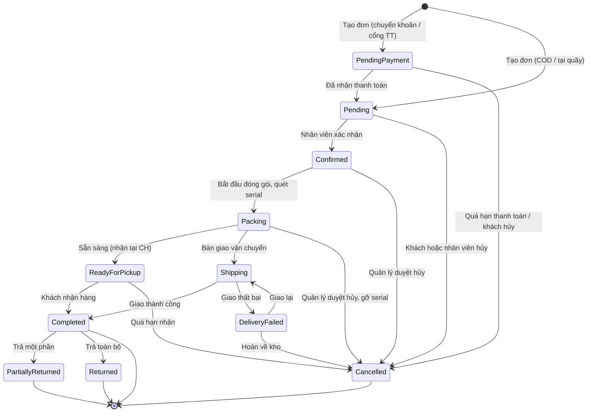
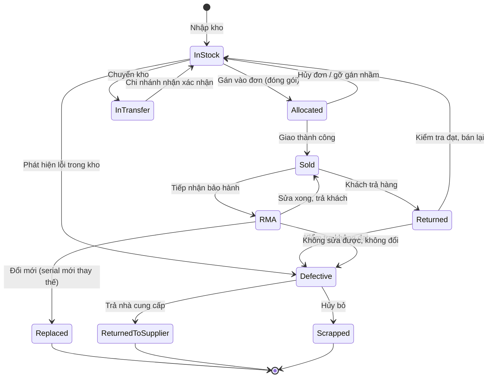
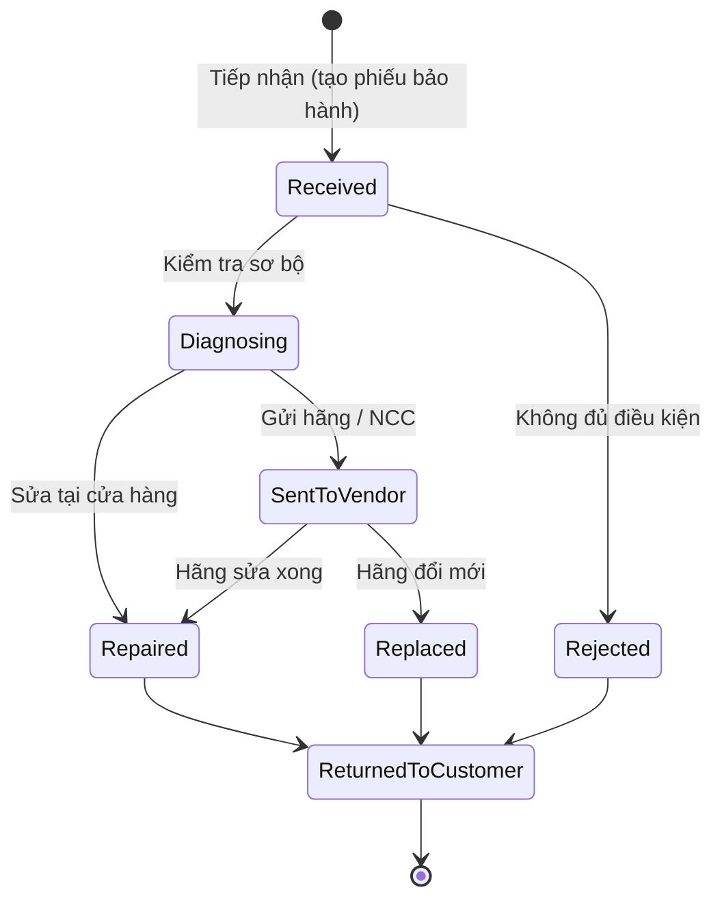

# TÀI LIỆU ĐẶC TẢ NGHIỆP VỤ (BRD)

## Hệ thống Bán hàng & Quản lý Doanh nghiệp Linh kiện Điện tử

| Mục | Nội dung |
|---|---|
| Quy ước mã yêu cầu | `PRD` sản phẩm · `PRC` giá/khuyến mãi · `CART` giỏ hàng · `ORD` đơn hàng · `PAY` thanh toán · `INV` kho · `SER` serial · `WAR` bảo hành · `RET` đổi trả · `SUP` nhà cung cấp · `HR` nhân sự · `KPI` hoa hồng · `AUD` nhật ký · `NFR` phi chức năng |

---

## 1. TỔNG QUAN

### 1.1. Mục tiêu

Xây dựng hệ thống phục vụ mô hình **bán lẻ và bán sỉ linh kiện máy tính** (CPU, RAM, ổ cứng, màn hình, và các nhóm khác), bao gồm: bán hàng online/tại quầy, quản lý kho theo số lượng và theo serial, bảo hành điện tử, quản lý nhân sự vận hành và báo cáo.

### 1.2. Phạm vi

**Trong phạm vi (In scope)**

- Danh mục hàng hóa với thông số kỹ thuật theo từng loại linh kiện, lọc và kiểm tra tương thích.
- Giá bán lẻ, giá sỉ theo nhóm khách, khuyến mãi, mã giảm giá.
- Giỏ hàng, đặt hàng, thanh toán, giao nhận / nhận tại cửa hàng.
- Kho nhiều chi nhánh: nhập, xuất, chuyển kho, kiểm kê, quản lý serial.
- Nhà cung cấp và công nợ nhà cung cấp.
- Bảo hành, đổi trả.
- Nhân sự, phân quyền RBAC, chấm công, hoa hồng/KPI.
- Nhật ký hệ thống (Audit Log) và báo cáo.

**Ngoài phạm vi (Out of scope), chưa làm ở giai đoạn này**

- Kế toán tổng hợp, xuất hóa đơn điện tử (chỉ cung cấp dữ liệu để tích hợp sau).
- Tính lương chi tiết (chỉ tổng hợp giờ công và hoa hồng).
- Ứng dụng di động riêng cho nhân viên.
- Tính năng "xây dựng cấu hình PC" (PC Builder) hoàn chỉnh; giai đoạn này chỉ có kiểm tra tương thích cơ bản (mục 3.4).

### 1.3. Thuật ngữ

| Thuật ngữ | Ý nghĩa |
|---|---|
| SKU | Mã định danh một mặt hàng (loại sản phẩm), không phải từng cái hàng vật lý |
| Serial | Mã định danh của **từng đơn vị hàng vật lý** |
| Physical Stock (Tồn thực tế) | Số lượng hàng thực sự đang nằm trong kho |
| Reserved Stock (Tồn đang giữ) | Số lượng đã được giữ cho các đơn chưa giao xong |
| Available Stock (Tồn khả dụng) | `Available = Physical − Reserved`, là số lượng có thể bán tiếp |
| RMA | Return Merchandise Authorization, quy trình bảo hành/đổi trả |
| TPT | Table-Per-Type, mô hình bảng cha - bảng con |

### 1.4. Giả định và ràng buộc

- Một đơn hàng thuộc đúng **một chi nhánh xuất hàng**. Đơn cần hàng từ nhiều chi nhánh phải được tách thành nhiều đơn con hoặc chuyển kho trước.
- Tiền tệ duy nhất: VND, số nguyên (không có phần thập phân).
- Mọi thời điểm được lưu theo UTC, hiển thị theo múi giờ Việt Nam.
- Quy định thời gian bảo hành, thời hạn giữ hàng, hạn đổi trả là **cấu hình hệ thống** (Admin chỉnh), không viết cứng trong code.

---

## 2. ĐỐI TƯỢNG SỬ DỤNG VÀ PHÂN QUYỀN

### 2.1. Nhóm đối tượng

| Nhóm | Mô tả |
|---|---|
| **Khách hàng (Customer)** | Tìm kiếm, lọc theo thông số, đặt hàng, theo dõi đơn, tra cứu bảo hành. Gồm *khách lẻ* và *khách sỉ (đại lý)* |
| **Nhân viên (Staff)** | Gồm các chức vụ: Thu ngân, Tư vấn kỹ thuật, Thủ kho, Quản lý chi nhánh |
| **Quản trị viên (Admin)** | Toàn quyền cấu hình hệ thống, giá, khuyến mãi, nhân sự, báo cáo |

### 2.2. Ma trận phân quyền (RBAC)

Ký hiệu: **X** = toàn quyền · **R** = chỉ xem · **C** = tạo · **U** = sửa · **A** = duyệt · **—** = không có quyền. Quyền của nhân viên chỉ áp dụng **trong chi nhánh được gán**, trừ Admin.

| Chức năng | Khách hàng | Thu ngân | Tư vấn KT | Thủ kho | Quản lý CN | Admin |
|---|---|---|---|---|---|---|
| Xem/lọc sản phẩm | R | R | R | R | R | X |
| Tạo/sửa sản phẩm, thuộc tính | — | — | — | — | — | X |
| Sửa giá bán, khuyến mãi | — | — | — | — | Đề xuất | X |
| Giỏ hàng, đặt hàng của mình | X | — | — | — | — | — |
| Tạo đơn tại quầy | — | C | C | — | C | X |
| Xác nhận / chuyển trạng thái đơn | Hủy khi Pending | U (đến giao xong) | R | U (đóng gói, xuất kho) | A | X |
| Hủy đơn đã xác nhận | — | — | — | — | A | X |
| Nhập kho, kiểm kê | — | — | — | C, U | A | X |
| Điều chỉnh tồn kho thủ công | — | — | — | Đề xuất | A | X |
| Chuyển kho nội bộ | — | — | — | C | A | X |
| Tiếp nhận / xử lý bảo hành | Tra cứu của mình | C | C, U | U | A | X |
| Duyệt đổi trả, hoàn tiền | — | Đề xuất | — | — | A | X |
| Quản lý nhân sự, phân quyền | — | — | — | — | R | X |
| Chấm công | Bản thân | Bản thân | Bản thân | Bản thân | Cả chi nhánh | X |
| Xem báo cáo doanh thu | — | — | Cá nhân | — | Chi nhánh | X |
| Xem báo cáo tồn kho | — | — | — | Chi nhánh | Chi nhánh | X |
| Xem Audit Log | — | — | — | — | Chi nhánh | X |

> Mọi thao tác "A" (duyệt) bắt buộc ghi Audit Log (mục 10).

---

## 3. QUẢN LÝ HÀNG HÓA VÀ THUỘC TÍNH

### 3.1. Mô hình dữ liệu Cha - Con (Table-Per-Type)

Mỗi nhóm linh kiện có thông số kỹ thuật khác nhau, vì vậy dữ liệu được tổ chức theo mô hình **Cha - Con**:

- **Bảng cha `Products`**: chứa thông tin chung, là bảng duy nhất mà Giỏ hàng, Đơn hàng, Kho, Giá làm việc cùng.
- **Bảng con `Specs_*`**: mỗi loại linh kiện một bảng, liên kết **1-1** với `Products`.

**Quy tắc dữ liệu**

- **PRD-01** Khóa chính của bảng con **đồng thời là khóa ngoại** trỏ về `Products.Id` (ví dụ `Specs_CPU.ProductId` là PK và FK), để bảo đảm quan hệ 1-1.
- **PRD-02** Mỗi sản phẩm thuộc đúng một `Category`; sản phẩm chỉ được có bản ghi ở **đúng bảng con tương ứng** với Category đó. Hệ thống phải chặn ở tầng nghiệp vụ và nên có ràng buộc ở tầng CSDL.
- **PRD-03** Đổi Category của sản phẩm đã tạo **không được phép** nếu sản phẩm đã có phát sinh (đơn, nhập kho, serial). Chỉ được tạo sản phẩm mới.
- **PRD-04** Khi Admin tạo sản phẩm: chọn **Loại linh kiện** trước → hệ thống hiển thị form thuộc tính tương ứng → lưu cha và con trong **cùng một giao dịch**.
- **PRD-05** Hệ thống cho phép mở rộng loại linh kiện mới. Với nhóm ít dùng, được phép lưu thuộc tính dạng linh hoạt (JSON) thay vì tạo bảng riêng; nhóm chính (mục 3.3) luôn dùng bảng riêng để lọc hiệu quả.

### 3.2. Bảng cha `Products`

| Nhóm | Trường |
|---|---|
| Định danh | Mã SKU (duy nhất), Tên sản phẩm, Slug (SEO), Thương hiệu, Danh mục (Category) |
| Mô tả | Mô tả ngắn, mô tả chi tiết, danh sách hình ảnh |
| Giá | Giá nhập gần nhất (chỉ tham khảo, giá vốn thực tế tính từ phiếu nhập), Giá niêm yết (lẻ) |
| Kho | Cờ `requires_serial` (có quản lý theo serial hay không), Mức tồn tối thiểu mặc định |
| Bảo hành | Thời hạn bảo hành mặc định (tháng), Điều kiện bảo hành |
| Trạng thái | Đang bán · Ngừng kinh doanh · Hết hàng · Nháp (chưa hiển thị) |

**Quy tắc**

- **PRD-06** Trạng thái **Hết hàng** do hệ thống tự suy ra từ `Available = 0` ở toàn bộ chi nhánh; không nhập tay.
- **PRD-07** **Ngừng kinh doanh**: không cho đặt mới, vẫn tra cứu được bảo hành và lịch sử.
- **PRD-08** Sản phẩm `requires_serial = true` (CPU, RAM, SSD, màn hình...) bắt buộc quản lý serial. Sản phẩm `requires_serial = false` (cáp, keo tản nhiệt, phụ kiện nhỏ) chỉ quản lý theo số lượng.
- **PRD-09** Không được xóa cứng sản phẩm đã có phát sinh; chỉ chuyển sang Ngừng kinh doanh.

### 3.3. Các bảng thuộc tính chuyên biệt

**`Specs_CPU`**: Socket (LGA1700, AM5...), Số nhân, Số luồng, Xung nhịp cơ bản, Xung nhịp boost, Bộ nhớ đệm (Cache), TDP, Có kèm quạt tản nhiệt (bool), Có card đồ họa tích hợp (bool).

**`Specs_RAM`**: Chuẩn (DDR4, DDR5), Dung lượng mỗi kit, Số thanh trong kit (1 hoặc 2), Bus, Độ trễ CL, Dạng (DIMM / SO-DIMM), Có LED RGB (bool).

**`Specs_Storage`**: Loại (SSD NVMe, SSD SATA, HDD), Chuẩn giao tiếp (PCIe Gen 4x4, SATA III...), Kích thước (M.2 2280, 2.5 inch, 3.5 inch), Dung lượng, Tốc độ đọc tối đa, Tốc độ ghi tối đa.

**`Specs_Monitor`**: Kích thước (inch), Độ phân giải, Tấm nền (IPS, VA, OLED), Tần số quét (Hz), Thời gian phản hồi (ms), Độ phủ màu sRGB (%), Cổng kết nối (HDMI, DP, Type-C; có thể nhiều giá trị).

**Các bảng bổ sung (cần thiết để kiểm tra tương thích, ưu tiên làm sớm)**

**`Specs_Mainboard`**: Socket, Chipset, Chuẩn RAM hỗ trợ, Số khe RAM, Bus RAM tối đa, Kích thước (ATX, mATX, ITX), Số khe M.2, Số cổng SATA.

**`Specs_PSU`**: Công suất (W), Chuẩn hiệu suất (80+ Bronze...), Dạng module (full / semi / non).

**`Specs_GPU`** và **`Specs_Case`**: bổ sung khi mở rộng danh mục.

### 3.4. Kiểm tra tương thích (Compatibility)

- **PRD-10** Hệ thống cung cấp kiểm tra tương thích **ở mức cảnh báo** (không chặn đặt hàng), áp dụng khi khách có nhiều linh kiện trong giỏ:
  - CPU ↔ Mainboard: cùng Socket.
  - RAM ↔ Mainboard: cùng chuẩn DDR; số thanh không vượt số khe.
  - Tổng TDP (CPU + GPU) so với công suất PSU: cảnh báo nếu vượt ngưỡng cấu hình (mặc định 80% công suất PSU).
- **PRD-11** Quy tắc tương thích là **dữ liệu cấu hình** (Admin xem được), không viết cứng rải rác trong code.

### 3.5. Tìm kiếm và lọc

- **PRD-12** Lọc chung (áp dụng mọi loại): Danh mục, Thương hiệu, Khoảng giá, Còn hàng / Hết hàng, Có khuyến mãi.
- **PRD-13** Lọc chuyên biệt theo thuộc tính của từng Category (ví dụ RAM: chuẩn DDR, dung lượng, bus; Monitor: kích thước, độ phân giải, tần số quét).
- **PRD-14** Sắp xếp: giá, mới nhất, bán chạy, mức giảm giá.

---

## 4. GIÁ VÀ KHUYẾN MÃI

- **PRC-01** **Bảng giá theo nhóm khách**: ít nhất 2 nhóm là *Khách lẻ* và *Khách sỉ (đại lý)*; mỗi nhóm có giá bán riêng cho từng sản phẩm. Khách chưa đăng nhập luôn dùng giá khách lẻ.
- **PRC-02** **Giá bậc thang theo số lượng** (bán sỉ): ví dụ mua từ 10 cái giá A, từ 50 cái giá B. Cấu hình theo sản phẩm hoặc theo danh mục.
- **PRC-03** **Khuyến mãi có thời hạn**: mỗi chương trình có ngày bắt đầu, ngày kết thúc, phạm vi áp dụng (sản phẩm / thương hiệu / danh mục), mức giảm (% hoặc số tiền), giới hạn số lượng và giới hạn số lần mỗi khách.
- **PRC-04** **Mã giảm giá (voucher)**: giá trị tối thiểu của đơn, thời hạn, số lần dùng, nhóm khách áp dụng, có hoặc không cộng dồn với khuyến mãi khác.
- **PRC-05** Thứ tự ưu tiên khi nhiều mức giá cùng áp dụng được định nghĩa rõ: *Giá sỉ bậc thang → Khuyến mãi sản phẩm → Voucher*. Mặc định **không cộng dồn** hai khuyến mãi sản phẩm; chỉ voucher được cộng dồn nếu cấu hình cho phép.
- **PRC-06** **Giá bán không được thấp hơn giá vốn** nếu không có phê duyệt của Quản lý/Admin. Khi vi phạm, hệ thống chặn và yêu cầu duyệt.
- **PRC-07** Mọi thay đổi giá, khuyến mãi đều ghi Audit Log (giá cũ, giá mới, người sửa).
- **PRC-08** **Bán sỉ - công nợ**: khách sỉ có thể được cấp **hạn mức công nợ** và **kỳ hạn thanh toán**. Đơn vượt hạn mức hoặc khách có nợ quá hạn bị chặn ở bước xác nhận, cần Quản lý duyệt.

---

## 5. GIỎ HÀNG

### 5.1. Cấu trúc và hợp nhất đa sản phẩm

- **CART-01** Giỏ hàng chỉ làm việc với bảng cha `Products`, cho phép thêm đồng thời RAM, CPU, màn hình, ổ cứng... vào cùng một giỏ.
- **CART-02** Khách chưa đăng nhập có giỏ tạm (lưu trên thiết bị); khi đăng nhập, giỏ tạm được **gộp** vào giỏ tài khoản (cùng sản phẩm thì cộng số lượng, bị giới hạn bởi tồn khả dụng).

### 5.2. Tick chọn (Selective Checkout)

- **CART-03** Mỗi dòng có cờ `is_selected` (mặc định `true` khi mới thêm). Có "Chọn tất cả" và bỏ chọn lẻ.
- **CART-04** Tổng tiền tạm tính **chỉ cộng các dòng đang được tick**: `Thành tiền = Đơn giá × Số lượng`.
- **CART-05** Khi bấm "Đặt hàng", **chỉ các dòng được tick** được chuyển thành đơn; các dòng không tick giữ nguyên trong giỏ.

### 5.3. Kiểm tra tồn kho

- **CART-06** Không cho tăng số lượng vượt `Available Stock`.
- **CART-07** Khi mở giỏ hoặc bấm đặt hàng, hệ thống kiểm tra lại tồn kho:
  - Hết hàng hoàn toàn: **tự bỏ tick**, hiển thị cảnh báo. Khi hàng có lại, **không tự tick lại**; khách tự chọn.
  - Tồn còn ít hơn số lượng trong giỏ: **tự giảm số lượng về mức tồn khả dụng** và báo cho khách. Khách quyết định có đặt tiếp hay không.
- **CART-08** Tồn kho kiểm tra theo **chi nhánh xuất hàng** phù hợp với hình thức nhận hàng (xem 6.2).

### 5.4. Giá trong giỏ

- **CART-09** Giá hiển thị trong giỏ chỉ là **tạm tính**, luôn tính lại theo bảng giá hiện hành. Nếu giá thay đổi kể từ lần xem trước, hệ thống thông báo cho khách.
- **CART-10** Giá chốt thực sự là giá tại **thời điểm tạo đơn**, và được lưu snapshot (mục 6.3).
- **CART-11** Giỏ hàng không giữ tồn kho; việc giữ hàng chỉ xảy ra khi tạo đơn.

---

## 6. ĐƠN HÀNG VÀ THANH TOÁN

### 6.1. Mô hình tồn kho

Mỗi SKU, tại mỗi chi nhánh, theo dõi ba số liệu:

```
Available = Physical − Reserved
```

- **Reserved** tăng khi đơn được tạo (giữ hàng), giảm khi đơn bị hủy hoặc giao xong.
- **Physical** chỉ giảm khi hàng **thực sự rời kho / giao thành công** (mục 6.4).

### 6.2. Hình thức nhận hàng

- **ORD-01** **Giao tận nơi**: hệ thống chọn chi nhánh xuất theo quy tắc cấu hình (gần nhất có đủ hàng, hoặc kho mặc định). Phí vận chuyển tính theo cấu hình.
- **ORD-02** **Nhận tại cửa hàng**: khách chọn **chi nhánh nhận**; tồn kho được kiểm tra và giữ tại chi nhánh đó. Khách có hạn (cấu hình, mặc định 3 ngày) để đến nhận; quá hạn, đơn tự hủy và nhả tồn.
- **ORD-03** Đơn tại quầy (do Thu ngân/Tư vấn tạo) dùng chi nhánh của nhân viên và có thể đi thẳng tới trạng thái Hoàn tất khi thanh toán và giao hàng xảy ra cùng lúc.

### 6.3. Nguyên tắc dữ liệu đơn hàng

- **ORD-04** **Snapshot khi tạo đơn**: chi tiết đơn lưu cố định tên sản phẩm, SKU, đơn giá đã áp dụng, khuyến mãi/voucher, số lượng, thời hạn bảo hành tại thời điểm đặt. Thay đổi giá sau đó **không ảnh hưởng** đơn đã tạo.
- **ORD-05** Đơn hàng lưu `Sales_Staff_ID` (nhân viên tư vấn) nếu có (xem mục 9.3).
- **ORD-06** Mã đơn hàng duy nhất, sinh tự động, không đoán được tuần tự đối với khách hàng ngoài.

### 6.4. Vòng đời đơn hàng



| Trạng thái | Ý nghĩa |
|---|---|
| PendingPayment | Chờ khách thanh toán (chuyển khoản / cổng thanh toán). Đã giữ hàng, có đồng hồ đếm ngược |
| Pending | Đã tạo, chờ nhân viên xác nhận. COD vào thẳng trạng thái này |
| Confirmed | Nhân viên đã kiểm tra thông tin, tồn kho, thanh toán |
| Packing | Đang lấy hàng, quét serial gán vào đơn |
| ReadyForPickup | Hàng đã chuẩn bị xong tại cửa hàng, chờ khách đến |
| Shipping | Đã bàn giao đơn vị vận chuyển |
| DeliveryFailed | Giao không thành công (không liên lạc được, từ chối nhận) |
| Completed | Đã giao / đã nhận thành công |
| Cancelled | Đã hủy trước khi hoàn tất |
| PartiallyReturned / Returned | Có đổi trả sau khi hoàn tất (mục 8) |

**Quy tắc chuyển trạng thái**

- **ORD-07** Chỉ các chuyển trạng thái vẽ trên sơ đồ mới hợp lệ; mọi chuyển khác bị từ chối.
- **ORD-08** Mỗi lần chuyển trạng thái lưu: người thực hiện, thời điểm, lý do (bắt buộc với hủy và giao thất bại).
- **ORD-09** Quyền chuyển trạng thái theo ma trận ở mục 2.2.

### 6.5. Tác động của từng bước lên tồn kho và serial

| Sự kiện | Physical | Reserved | Available | Serial |
|---|---|---|---|---|
| Tạo đơn (giữ hàng) | không đổi | **+ SL** | **− SL** | không đổi |
| Xác nhận đơn | không đổi | không đổi | không đổi | không đổi |
| Quét serial khi đóng gói | không đổi | không đổi | không đổi | `InStock` → `Allocated` |
| Giao thành công / khách nhận | **− SL** | **− SL** | không đổi | `Allocated` → `Sold` (kích hoạt bảo hành) |
| Hủy **trước** khi giao | không đổi | **− SL** | **+ SL** | `Allocated` → `InStock` (gỡ khỏi đơn) |
| Giao thất bại rồi hoàn về kho | không đổi | **− SL** | **+ SL** | `Allocated` → `InStock` |
| Trả hàng **sau** khi hoàn tất | **+ SL** (khi nhập lại kho) | không đổi | **+ SL** | `Sold` → `Returned` → theo kết quả kiểm tra (mục 7.3) |

- **ORD-10** Việc giữ hàng (tăng Reserved) phải **an toàn khi nhiều người mua đồng thời**: hai khách không thể cùng giữ thành công món hàng cuối cùng. Thao tác giữ hàng cần cơ chế khóa/giao dịch phù hợp.
- **ORD-11** **Timeout giữ hàng**: đơn `PendingPayment` quá thời hạn cấu hình (mặc định 30 phút với cổng thanh toán, 24 giờ với chuyển khoản) sẽ **tự hủy** và nhả tồn. Tác vụ nền chạy định kỳ.
- **ORD-12** Đơn `Pending` COD không xác nhận quá thời hạn cấu hình (mặc định 24 giờ) được nhắc Quản lý xử lý; không tự hủy trừ khi cấu hình bật.
- **ORD-13** Sau khi đơn hoàn tất, không được sửa chi tiết đơn; mọi điều chỉnh đi qua đổi trả hoặc hoàn tiền (có phê duyệt).

### 6.6. Thanh toán

- **PAY-01** Phương thức: **COD**, **Chuyển khoản**, **Cổng thanh toán**, **Tiền mặt/POS tại quầy**, **Công nợ** (chỉ khách sỉ được cấp hạn mức).
- **PAY-02** **Cổng thanh toán**: xử lý callback phải **idempotent** (nhận cùng một giao dịch nhiều lần chỉ ghi nhận một lần), kiểm tra chữ ký, đối chiếu số tiền với đơn. Không tin kết quả từ trình duyệt của khách, chỉ tin callback/truy vấn từ phía cổng.
- **PAY-03** **Chuyển khoản**: đối soát bằng nội dung chuyển khoản chứa mã đơn; thu ngân/kế toán xác nhận thủ công hoặc tự động khi có tích hợp ngân hàng. Chuyển thiếu hoặc thừa tiền được đánh dấu để xử lý.
- **PAY-04** Hoàn tiền: chỉ qua quy trình đổi trả/hủy được duyệt, hoàn đúng phương thức gốc nếu có thể; ghi nhận giao dịch hoàn tiền riêng, không sửa giao dịch gốc.
- **PAY-05** Doanh thu chỉ được ghi nhận khi đơn **Completed** và đã thanh toán (hoặc ghi nhận công nợ phải thu đối với khách sỉ).

---

## 7. QUẢN LÝ KHO VÀ SERIAL

### 7.1. Kho theo số lượng

- **INV-01** Tồn kho theo dõi **theo từng chi nhánh** và từng SKU: Tổng nhập, Tổng xuất, Physical, Reserved, Available.
- **INV-02** **Cảnh báo tồn tối thiểu (Min-stock)**: cấu hình theo SKU và chi nhánh; khi `Available` thấp hơn ngưỡng, hệ thống cảnh báo Thủ kho và Quản lý.
- **INV-03** Mọi biến động tồn kho đều sinh một **bút toán kho (stock movement)** bất biến: loại (nhập, xuất bán, chuyển kho, kiểm kê, điều chỉnh, đổi trả), số lượng, chi nhánh, chứng từ gốc, người thực hiện, thời điểm. Số tồn là kết quả cộng dồn của các bút toán, không sửa trực tiếp.
- **INV-04** **Điều chỉnh tồn thủ công** (kiểm kê lệch, hư hỏng) bắt buộc có lý do và **phải được Quản lý duyệt**.
- **INV-05** **Kiểm kê**: lập phiếu kiểm kê theo chi nhánh; so sánh số đếm thực tế với hệ thống (với hàng có serial: so khớp danh sách serial); chênh lệch tạo phiếu điều chỉnh chờ duyệt.
- **INV-06** **Chuyển kho nội bộ**: Thủ kho tạo phiếu chuyển (chi nhánh đi → chi nhánh đến); hàng ở trạng thái **đang chuyển (InTransfer)** không tính vào tồn khả dụng của cả hai chi nhánh; chi nhánh nhận xác nhận mới ghi nhận nhập. Với hàng có serial, serial đi theo phiếu chuyển.

### 7.2. Nhập kho và nhà cung cấp

- **SUP-01** Quản lý **Nhà cung cấp**: thông tin liên hệ, mã số thuế, điều khoản thanh toán, danh sách sản phẩm cung cấp.
- **INV-07** **Phiếu nhập kho** từ nhà cung cấp gồm: số lượng, đơn giá nhập, chi nhánh nhận. Với sản phẩm `requires_serial`, nhân viên **phải nhập hoặc quét đủ danh sách serial** khớp với số lượng; thiếu một serial thì không cho hoàn tất phiếu.
- **INV-08** Serial phải **duy nhất** trong toàn hệ thống (theo SKU hoặc toàn cục, theo cấu hình). Nhập trùng serial bị chặn và báo rõ serial nào trùng.
- **INV-09** **Giá vốn**: tính theo phương pháp cấu hình (mặc định bình quân gia quyền); với hàng có serial có thể lưu giá nhập của từng serial. Giá vốn phục vụ báo cáo lợi nhuận và ràng buộc PRC-06.
- **SUP-02** **Công nợ nhà cung cấp**: ghi nhận phải trả theo phiếu nhập, thanh toán từng phần, theo dõi hạn thanh toán.
- **SUP-03** **Trả hàng nhà cung cấp**: lập phiếu trả (hàng lỗi, bảo hành hãng), trừ tồn, serial chuyển trạng thái `ReturnedToSupplier`, giảm công nợ tương ứng.

### 7.3. Vòng đời Serial



| Trạng thái | Ý nghĩa | Tính vào Available |
|---|---|---|
| InStock | Trong kho, sẵn sàng bán | Có |
| Allocated | Đã gán cho đơn, chưa giao | Không (đang nằm trong Reserved) |
| InTransfer | Đang chuyển giữa chi nhánh | Không |
| Sold | Đã bán, đang trong tay khách | Không |
| RMA | Đang bảo hành tại cửa hàng / gửi hãng | Không |
| Returned | Khách trả, chờ kiểm tra | Không |
| Replaced | Đã được thay bằng serial khác (kết thúc) | Không |
| Defective | Lỗi, chờ xử lý | Không |
| ReturnedToSupplier / Scrapped | Đã trả NCC / đã hủy (kết thúc) | Không |

**Quy tắc**

- **SER-01** Chỉ serial ở `InStock` mới được gán vào đơn.
- **SER-02** Mỗi serial chỉ gán cho **một đơn tại một thời điểm**. Gán nhầm được **gỡ gán** trước khi giao; gỡ gán ghi Audit Log.
- **SER-03** Mọi chuyển trạng thái serial lưu lịch sử (từ trạng thái nào sang trạng thái nào, ai, khi nào, chứng từ liên quan).
- **SER-04** **Tra cứu bảo hành bằng serial**: quét mã trên tem để xem ngay SKU, ngày mua, đơn hàng, khách hàng, thời hạn bảo hành còn lại, lịch sử bảo hành của serial đó.

---

## 8. BẢO HÀNH VÀ ĐỔI TRẢ

### 8.1. Bảo hành điện tử

- **WAR-01** Thời hạn bảo hành **bắt đầu tính từ ngày giao thành công** (chuyển serial sang `Sold`), không phải ngày đặt hàng. Thời hạn lấy từ snapshot lúc đặt (ORD-04).
- **WAR-02** Khách tra cứu bảo hành của mình bằng serial hoặc trong lịch sử đơn hàng.
- **WAR-03** Hàng không có serial (`requires_serial = false`) được bảo hành theo **đơn hàng** (cần hóa đơn/mã đơn).

### 8.2. Quy trình bảo hành



- **WAR-04** **Tiếp nhận**: nhân viên quét serial, hệ thống kiểm tra còn hạn hay không và hiển thị thông tin liên quan. Nhân viên ghi nhận tình trạng thực tế (kèm hình ảnh nếu cần), phụ kiện đi kèm, sinh **phiếu tiếp nhận** có mã để khách theo dõi.
- **WAR-05** **Từ chối bảo hành** khi: hết hạn; tem/serial bị rách hoặc sửa; hư hỏng do tác động vật lý hoặc vào nước; không đúng điều kiện bảo hành đã ghi. Lý do từ chối bắt buộc nhập và khách được thông báo.
- **WAR-06** **Đổi mới**: serial cũ chuyển `Replaced`, serial mới chuyển `Sold` và gắn vào phiếu. **Thời hạn bảo hành của serial mới = thời hạn còn lại của serial cũ** (mặc định), trừ khi chính sách cấu hình khác; hệ thống lưu liên kết serial cũ ↔ serial mới.
- **WAR-07** Mỗi phiếu có lịch sử trạng thái, người xử lý, và thông báo cho khách khi đổi trạng thái chính (nhận, sửa xong, sẵn sàng trả).
- **WAR-08** Chi phí bảo hành ngoài chính sách (nếu có) được ghi nhận thanh toán riêng.

### 8.3. Đổi trả

- **RET-01** Hạn đổi trả cấu hình theo nhóm sản phẩm (ví dụ 7 ngày kể từ ngày giao), kèm điều kiện (nguyên seal, đủ phụ kiện, không lỗi do người dùng).
- **RET-02** Đổi trả có thể **một phần** (một số sản phẩm của đơn) hoặc toàn bộ; đơn chuyển `PartiallyReturned` hoặc `Returned`.
- **RET-03** Hàng trả về vào trạng thái `Returned` chờ kiểm tra: đạt → `InStock` (cộng lại Physical và Available); không đạt → `Defective`.
- **RET-04** Mọi đổi trả và hoàn tiền **do Quản lý duyệt**, ghi Audit Log.
- **RET-05** Đổi trả làm phát sinh **thu hồi hoa hồng** (mục 9.3).

---

## 9. NHÂN SỰ VÀ VẬN HÀNH

### 9.1. Hồ sơ nhân viên và phân quyền

- **HR-01** Hồ sơ gồm thông tin cá nhân, chức vụ (Thu ngân, Tư vấn kỹ thuật, Thủ kho, Quản lý), chi nhánh làm việc, trạng thái (đang làm, nghỉ việc).
- **HR-02** Nhân viên được gán **nhóm quyền** theo ma trận mục 2.2. Nhân viên chuyển chi nhánh phải cập nhật phạm vi truy cập.
- **HR-03** Nhân viên nghỉ việc: **vô hiệu hóa tài khoản** ngay; không xóa hồ sơ vì còn gắn với đơn hàng, Audit Log, hoa hồng.

### 9.2. Ca làm việc và chấm công

- **HR-04** Phân ca: Ca sáng, Ca chiều, Full-time (cấu hình khung giờ); Quản lý chi nhánh xếp ca.
- **HR-05** Ghi nhận check-in / check-out tại cửa hàng. Quy định cách chống gian lận (ví dụ chỉ check-in từ thiết bị hoặc mạng của cửa hàng).
- **HR-06** Xử lý ngoại lệ: quên check-in/out, đi muộn, về sớm, làm thêm giờ, cần Quản lý duyệt điều chỉnh (có lưu lý do, Audit Log).

### 9.3. Hoa hồng và KPI bán hàng

- **KPI-01** Mỗi đơn có `Sales_Staff_ID`. Doanh số và hoa hồng tính **khi đơn `Completed`**, không tính ở bước tạo đơn.
- **KPI-02** **Đơn khách tự đặt online** (không qua tư vấn): `Sales_Staff_ID` để trống và **không tính hoa hồng**, trừ khi khách nhập mã nhân viên giới thiệu (nếu doanh nghiệp bật tính năng).
- **KPI-03** **Nhiều nhân viên cùng tư vấn một đơn**: hỗ trợ chia tỷ lệ hoa hồng (tổng 100%); mặc định một người chịu trách nhiệm chính.
- **KPI-04** **Thu hồi hoa hồng**: khi đơn đã tính hoa hồng bị đổi trả/hoàn tiền, hoa hồng tương ứng được **trừ vào kỳ gần nhất** (có thể làm số dư âm), theo đúng tỷ lệ phần hàng bị trả.
- **KPI-05** Công thức hoa hồng cấu hình được: theo % doanh thu, theo % lợi nhuận gộp, theo nhóm sản phẩm, có thưởng vượt chỉ tiêu. Công thức áp dụng được lưu cùng kỳ tính để truy vết.
- **KPI-06** **Chốt kỳ**: cuối tháng hệ thống tổng hợp, Quản lý duyệt, sau khi chốt không sửa trực tiếp; điều chỉnh phải đi qua bút toán điều chỉnh ở kỳ sau.

---

## 10. NHẬT KÝ HỆ THỐNG (AUDIT LOG)

- **AUD-01** Ghi nhận ít nhất các thao tác nhạy cảm sau:
  - Sửa giá bán, giá sỉ, khuyến mãi, voucher.
  - Hủy đơn, đổi trả, hoàn tiền, đảo trạng thái đơn.
  - Điều chỉnh tồn kho, duyệt phiếu kiểm kê, gỡ gán serial, thay đổi trạng thái serial thủ công.
  - Đổi quyền, tạo/khóa tài khoản, thay đổi hồ sơ nhân viên.
  - Sửa hoa hồng, điều chỉnh chấm công, chốt kỳ.
  - Xuất dữ liệu số lượng lớn, đăng nhập thất bại nhiều lần.
- **AUD-02** Mỗi bản ghi gồm: **ai** (user), **làm gì** (hành động), **đối tượng** (loại và mã), **giá trị cũ và giá trị mới**, **thời điểm**, **IP/thiết bị**, **chi nhánh**, lý do (nếu có).
- **AUD-03** Log là **chỉ ghi thêm (append-only)**: không ai kể cả Admin được sửa hoặc xóa. Có chính sách lưu trữ (tối thiểu theo cấu hình, ví dụ 2 năm).
- **AUD-04** Quản lý chỉ xem log của chi nhánh mình; Admin xem toàn bộ. Có tìm kiếm và lọc theo người, thời gian, loại hành động.

---

## 11. BÁO CÁO

- **Doanh thu**: theo ngày/tháng, chi nhánh, nhóm sản phẩm, nhân viên, phương thức thanh toán.
- **Lợi nhuận gộp**: doanh thu trừ giá vốn.
- **Tồn kho**: theo chi nhánh/SKU, hàng dưới mức tối thiểu, hàng tồn lâu, giá trị tồn kho.
- **Serial**: số lượng theo từng trạng thái, truy vết lịch sử một serial.
- **Bảo hành & đổi trả**: số phiếu, tỷ lệ lỗi theo sản phẩm/nhà cung cấp, thời gian xử lý trung bình.
- **Công nợ**: phải thu (khách sỉ), phải trả (nhà cung cấp), theo độ tuổi nợ.
- **Nhân sự**: giờ công, doanh số, hoa hồng, tỷ lệ đạt chỉ tiêu.

---

## 12. YÊU CẦU PHI CHỨC NĂNG

| Mã | Yêu cầu |
|---|---|
| NFR-01 | **Toàn vẹn dữ liệu kho**: giữ hàng, trừ kho, gán serial thực hiện trong giao dịch; chịu được nhiều người đặt cùng lúc mà không bán vượt tồn |
| NFR-02 | **Hiệu năng**: trang danh sách/lọc sản phẩm phản hồi trong thời gian mục tiêu cấu hình (đề xuất dưới 2 giây ở điều kiện bình thường); số người dùng đồng thời mục tiêu cần được chốt với doanh nghiệp |
| NFR-03 | **Bảo mật**: xác thực mạnh cho nhân viên, mật khẩu băm an toàn, phiên đăng nhập có thời hạn, chống truy cập vượt quyền theo chi nhánh, không lưu dữ liệu thẻ thanh toán |
| NFR-04 | **Sao lưu & phục hồi**: sao lưu định kỳ, có kế hoạch phục hồi và thử nghiệm phục hồi |
| NFR-05 | **Khả năng truy vết**: mọi thay đổi dữ liệu nghiệp vụ quan trọng truy ngược được người và thời điểm |
| NFR-06 | **Khả năng mở rộng**: thêm loại linh kiện, chi nhánh, phương thức thanh toán mà không phải sửa lõi nghiệp vụ |
| NFR-07 | **Khả dụng**: thời gian ngừng hoạt động cho phép và cửa sổ bảo trì cần thống nhất với doanh nghiệp |
| NFR-08 | **Đa ngôn ngữ / định dạng**: hiển thị tiếng Việt, định dạng tiền VND, múi giờ Việt Nam |
| NFR-09 | **Tác vụ nền**: hủy đơn quá hạn giữ hàng, cảnh báo tồn tối thiểu, nhắc việc chạy định kỳ, có giám sát và chạy lại an toàn (idempotent) |

---

## 13. NHỮNG ĐIỂM CẦN CHỐT VỚI DOANH NGHIỆP

Các điểm dưới đây tài liệu đã đặt giá trị mặc định đề xuất nhưng cần doanh nghiệp xác nhận:

1. Kho tính tồn **theo từng chi nhánh** (đề xuất) hay một kho tổng?
2. Thời hạn giữ hàng cho từng phương thức thanh toán (30 phút / 24 giờ / 3 ngày nhận tại cửa hàng).
3. Serial duy nhất **theo SKU** hay **toàn hệ thống**.
4. Bảo hành khi đổi mới: **kế thừa thời hạn còn lại** hay tính lại từ đầu.
5. Công thức hoa hồng và việc tính hoa hồng cho đơn online có mã giới thiệu.
6. Chính sách đổi trả: số ngày, danh mục nào không được đổi trả.
7. Có triển khai **bán sỉ có công nợ** ngay giai đoạn 1 hay để giai đoạn sau (nếu để sau, loại PRC-01, PRC-02, PRC-08 và thanh toán Công nợ khỏi phạm vi).
8. Phương pháp tính giá vốn (bình quân gia quyền hay theo từng serial/lô).
9. Mức tích hợp thanh toán và vận chuyển cần có ở giai đoạn đầu.

---

## 14. TÀI LIỆU KÈM THEO DỰ KIẾN

- Sơ đồ ERD (bảng cha - con, kho, serial, đơn hàng).
- Sơ đồ trạng thái chi tiết (đơn hàng, serial, phiếu bảo hành) dựa trên các sơ đồ trong tài liệu này.
- Danh sách User Story và Test Case, truy vết theo mã yêu cầu (`CART-xx`, `INV-xx`...).